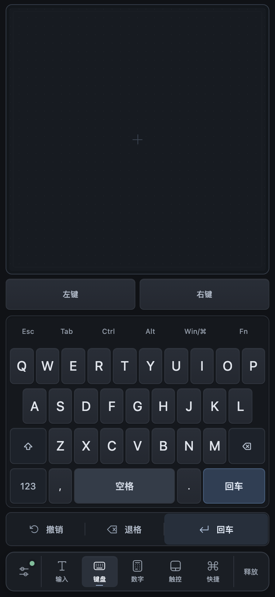
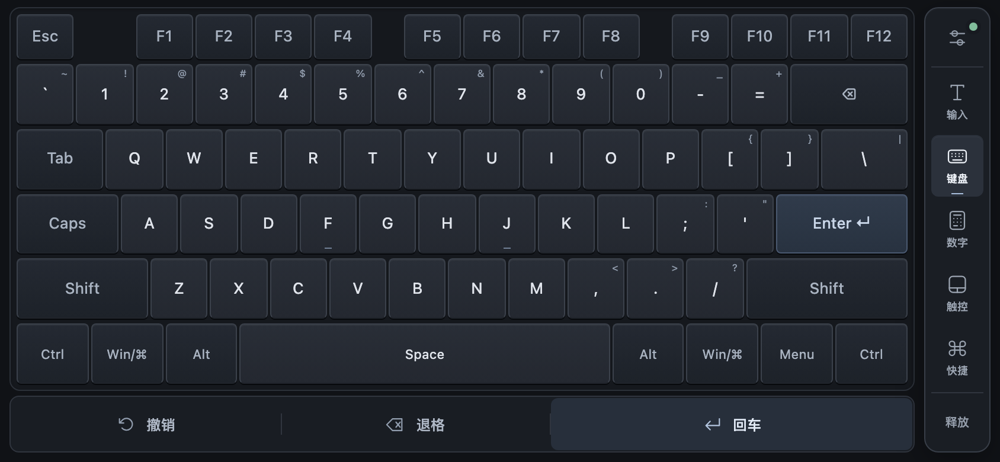
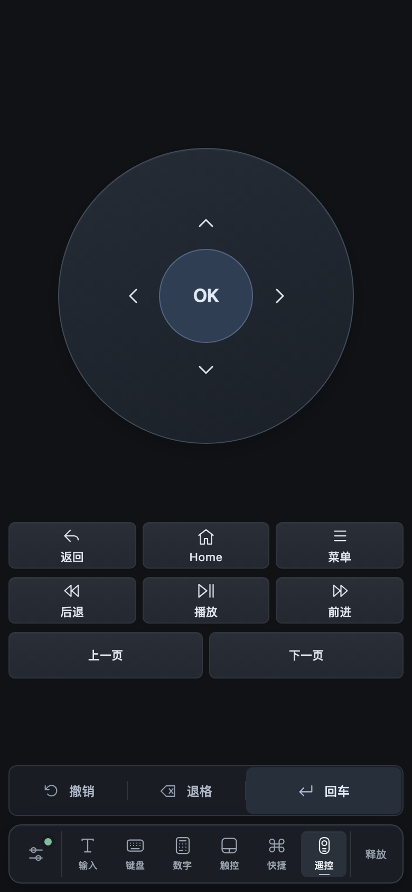
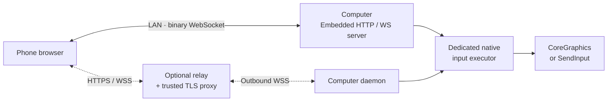

<div align="center">

# Nearby

### Your phone. Your keyboard. Your trackpad.

A LAN-first control surface for your Mac or Windows PC.<br>
One Rust binary on your computer. A browser on your phone. Nothing in between.

[](Cargo.toml)
[](#platforms--scope)
[](web)
[](#platforms--scope)

[Quick start](#quick-start) · [The controls](#the-controls) · [Architecture](#architecture) · [Development](#development)

</div>

---

<table>
  <tr>
    <td align="center" valign="top" width="32%">
      
      <p><b>Made for your thumbs.</b><br>Touchpad above. Phone-sized keys below.</p>
    </td>
    <td align="center" valign="top" width="68%">
      
      <p><b>Rotate for the whole keyboard.</b><br>Physical rows, function keys, and properly proportioned modifiers.</p>
      <br>
      <p>Compose text with your phone's native input method.<br>Move, scroll, click, and drag without switching devices.<br>Keep Enter, Backspace, and Undo within reach.</p>
      <p>No app install. No cloud account. No CDN.<br>No page scrolling. No decorative dashboard.</p>
    </td>
  </tr>
</table>

> [!IMPORTANT]
> **Use a trusted network.** The default LAN connection is HTTP/WebSocket, not encrypted.
> Pairing controls access; it does not protect against a hostile network observer.
> Never port-forward the default listener to the Internet.

## Why Nearby?

| Built for | What that means |
| :--- | :--- |
| **The same Wi-Fi** | Direct phone-to-computer WebSocket, without a relay in the hot path. |
| **Real desktop input** | Native CoreGraphics on macOS and `SendInput` on Windows—not a browser-only simulation. |
| **Mobile ergonomics** | Bottom-anchored QWERTY in portrait; a complete ANSI layout in landscape. |
| **Your own input method** | Compose locally with the phone's keyboard and IME, then commit Unicode text explicitly. |
| **Low overhead** | Immediate first motion, 4 ms micro-batching, binary commands, and a dedicated native input thread. |
| **Predictable recovery** | Exclusive ownership, an independent input lease, explicit errors, and no reconnect replay. |
| **A small footprint** | HTML, CSS, and ES modules embedded in one Rust binary. Node.js is only for development. |

## Quick start

**Requirements:** Rust 1.88+ and a Mac or Windows PC in an interactive desktop session.

```sh
git clone https://github.com/HSPK/webcontroller.git
cd webcontroller
cargo build --release
```

Start the controller on your computer:

| macOS | Windows / PowerShell |
| :--- | :--- |
| `./target/release/webcontroller` | `.\target\release\webcontroller.exe` |

**Scan the printed QR code on your phone. That's the setup.**

The default listener is `0.0.0.0:8787`. Keep both devices on the same reachable
network and permit inbound access on **private networks only** if the firewall asks.
Guest Wi-Fi and client isolation can prevent direct connections.

On macOS, grant the running executable or terminal **Accessibility** permission in
**System Settings → Privacy & Security → Accessibility**, then restart it.
Missing authorization is an explicit error; the program never silently falls
back to simulated input.

> [!TIP]
> Want to explore without touching your desktop? Run `cargo run -- --dry-run`.
> It serves the real UI and transport, but disables native input injection.

<details>
<summary><b>Network options, pairing, and shutdown</b></summary>

```sh
./target/release/webcontroller --host 192.168.1.20 --port 8787 --no-qr
```

The QR code uses the first detected non-loopback IPv4 interface. If that is a VPN
or virtual adapter, open the printed pairing link for the actual Wi-Fi address instead.

Pairing links expire after **five minutes** and are **single-use**. A fragment-based
ticket is exchanged for a credential held in the tab's `sessionStorage`; the fragment
is then removed from browser history. Credentials are not placed in HTTP request URLs
or WebSocket query strings. If session storage is unavailable, the UI warns that
refreshing will lose the pairing.

Only one controller can own input at a time. **Forget this pairing** clears the
current tab's credential; restarting the computer process revokes all issued
credentials. After restarting, scan the new QR code to pair again.

Press **Ctrl+C** to stop and release owned keys and mouse buttons. Unix SIGTERM
also requests graceful cleanup. Forced termination, crashes, and power loss
cannot guarantee delivery of release events to the OS.

</details>

## The controls

One floating bar. Six workspaces. No nested mode tabs.

| Workspace | Interaction |
| :--- | :--- |
| **Text** | Compose a local draft; **Send** commits it, **Send and Enter** waits for its ACK before requesting Enter. |
| **Keyboard** | Large QWERTY keys in portrait, `123` for symbols, `Fn` for functions/navigation; full ANSI in landscape. |
| **Numeric** | Navigation cluster and numpad, with double-height Plus/Enter and double-width zero. |
| **Touchpad** | Relative movement, clicks, two-finger scrolling, and dragging. |
| **Shortcuts** | Arrows, navigation, sticky modifiers, copy/paste/select/redo, and Space. |
| **TV remote** | A directional ring with OK, Back, Home, Menu, playback/navigation controls, and page buttons; side-by-side in compact layouts. |

**Undo, Backspace, and Enter always target the computer**, not the local draft.
An emergency **Release** clears owned keys and mouse buttons. Shortcuts automatically
choose Command on macOS or Control on Windows, with a manual override in Settings.

### TV-style remote

<p align="center">
  
</p>

The **Remote** workspace controls the connected computer, not a television through
IR, HDMI-CEC, or a smart-TV API. Its keyboard mappings are:

| Control | Computer key |
| :--- | :--- |
| Directional ring / OK | Arrow keys / Enter |
| Back / Home / Menu | Esc / Home / Application (Menu) |
| Playback / backward / forward | Space / Left / Right |
| Previous / next page | Page Up / Page Down |

Directions support hold-to-repeat and release when switching workspaces. Other
remote controls send a single press/release immediately on touch-down, without
repeating during a hold. Release held keys or mouse buttons before using them.
Playback, navigation, and Menu behavior depend on the focused application;
these are not global media keys or a TV home-screen command.

### Touchpad gestures

| Gesture | Result |
| :--- | :--- |
| Move one finger | Move the pointer |
| Tap | Left click |
| Tap with two fingers | Right click |
| Slide two fingers | Natural vertical/horizontal scrolling |
| Hold still for 350 ms, then move | Left-button drag; lift to release |
| Hold the separate left/right button and move | Drag with an explicit mouse button |
| Tap **Double click** | A left-button double click |

Motion starts immediately after gesture recognition, without waiting for the
next display frame. Subsequent updates are combined on a **4 ms scheduling budget**
with at most **two automatically sent motion commands awaiting ACK** per touchpad.
When capacity is exhausted, deltas accumulate locally and resume as soon as an ACK
frees capacity, rather than building a long sequence of stale movement packets.
Button boundaries force the final pending motion out before click/release commands;
this flush can temporarily exceed the automatic motion window to preserve ordering.
Browser/OS scheduling can delay timers; this is not a hard real-time guarantee.

Lifting one finger after scrolling does not turn the remaining finger
into a cursor movement or an accidental click. Desktop wheel events also scroll
the remote computer. Pressing the surface does not highlight the whole region.

### Designed around the phone

The workspace stays within one screen. Only a long text draft scrolls.
In portrait, the keyboard sits below the touchpad; in landscape at least 600 px
wide, the floating bar becomes a right-hand rail and the full keyboard takes over.
At reduced heights, the embedded touchpad is hidden to keep keys usable.

Sending text keeps the input field focused. Dismissing the phone keyboard does
**not** disconnect. Switching key layers or rotating releases active presses/drags
before hiding them, while explicitly toggled modifiers stay synchronized.

The Settings dot describes **ACK response quality**, not Wi-Fi signal strength:
gray means unpaired; green means stable; amber means connecting or variable/slow
responses; red means very slow responses or a disconnected paired session.
Details and RTT are available in Settings rather than occupying the workspace.

<details>
<summary><b>Text, focus, and mobile-browser behavior</b></summary>

- Text is composed locally with the native phone keyboard and IME. Composition
  is not mirrored as individual physical key events.
- The phone keyboard's Enter inserts a local newline. It does not submit the draft.
- Release modifiers and focus the destination application before submitting text.
  Physical keys follow USB HID positions; the computer's layout determines characters.
- Modifiers are explicit sticky toggles across tabs. Tap again or use **Release**.
- Text is limited to **16 KiB UTF-8**, with a **400 ms** native execution budget.
  Oversized drafts show a byte-limit warning and disable sending.
- **Send and Enter** never requests Enter after a failed/unconfirmed text submission.
  Once text is acknowledged, it is cleared even if Enter fails, preventing accidental
  resubmission. An error can still mean partial input: inspect the target before retrying.
- Sending restores focus synchronously during the tap, not after a network ACK.
  It does not steal focus back after a later mode change.
- `visualViewport` resizing/panning keeps the work area aligned with the visible screen.
- Autocomplete/correction/capitalization are disabled as browser hints. Safari can
  ignore these hints; ordinary web pages cannot hide iOS's keyboard-dismiss or
  password/card/address accessory controls.
- Window blur releases held controls without disconnecting. Backgrounding or
  leaving the page suspends the session; resume explicitly.

The quality indicator uses ACK RTT and smoothed consecutive-RTT variation:
green up to 80 ms with low variation; amber above 80 ms or variation above 30 ms;
red above 250 ms. Variation is an exponential average with weight 0.2.
Visible updates are limited to four per second; ACK processing is not throttled.

</details>

## Architecture

**Direct by default. Relay when you need it.**



The browser is dependency-free at runtime. Native input is serialized on one
dedicated thread with bounded channels. Key/button boundaries are sent immediately;
motion is micro-batched independently of painting, without repeatedly rewriting
keyboard controls or re-encoding drafts. Fixed-size commands encode directly into
one frame buffer; touch contact coordinates are updated in place.

<details>
<summary><b>Ordering, leases, and performance engineering</b></summary>

- A **250 ms** application heartbeat maintains a **1,200 ms** input lease.
  Transport pings do not renew it.
- The native executor releases its owned keys and mouse buttons on lease expiry,
  even if the relay is unreachable. Late traffic cannot revive an expired lease;
  a fresh session begins with a release/reset barrier.
- Repeat begins after **450 ms**, every **45 ms**. The input thread blocks until a
  command or the earliest timer deadline, without periodic polling when idle.
  Timer checks continue under pointer traffic so movement cannot starve key repeat.
- Failed watchdog operations are logged and retried with an **8 ms** backoff.
  OS scheduling is not hard real-time.
- Every control connection starts a new sequence space. Duplicate, missing, or
  invalid frames end the connection. Commands are never replayed on reconnect.
- Shortcuts are ordered single commands. Final motion is flushed before button
  release, preserving the end of a drag.
- Accepted server sockets and outbound daemon connections enable **TCP_NODELAY**,
  avoiding Nagle delays on small control/ACK packets. A TLS proxy has its own
  transport/buffering settings and must be configured separately.
- The macOS native input thread requests **user-interactive QoS** to prioritize
  input work under contention. It still blocks when idle; no real-time scheduling,
  busy-waiting, or process-wide priority changes are used. QoS failures are logged.
- ACK means the adapter completed its system API calls—not that the target
  application accepted or rendered the input. Exactly-once execution is not claimed.

</details>

### Measure, don't guess

```sh
npm run bench
```

The opt-in benchmark builds release and reports:

- **500 sequential movement ACKs** and **400 burst ACKs** with an eight-command window.
- Browser pointer-event-to-`WebSocket.send` delay during **60 frame-paced movements**,
  alongside keyboard/text-counter DOM-write counts.
- A separate **120-event synthetic wheel stream** at 4 ms intervals to expose
  scheduling delays independently of Chromium's frame-aligned pointer delivery.

It warms up and stops its own loopback-only dry-run fixtures without restarting
an existing controller. The synthetic stream measures the actual controller
handler/send path, not a physical phone's touch sampling or native injection.

> [!NOTE]
> Benchmark p50/p95/p99 measure local transport/UI overhead—not real Wi-Fi,
> native injection, or touch-to-photon latency. There is no production latency
> claim. Compare runs on the same machine and workload, then qualify real devices.

<details>
<summary><b>Binary protocol · version 1</b></summary>

Integers are little-endian. Every frame starts with:

```text
version:u8 = 1 | opcode:u8 | sequence:u32 | payload
```

| Opcode | Payload | Operation |
| :--- | :--- | :--- |
| 1 | HID usage `u16` | Key down |
| 2 | HID usage `u16` | Key up |
| 3 | UTF-8, 1–16,384 bytes, no NUL | Commit text |
| 4 | Empty | Release owned keys and mouse buttons |
| 5 | Empty | Renew input lease |
| 6 | 1–8 distinct HID usages `u16[]` | Ordered key chord, then release |
| 7 | Relative `x:i16, y:i16`, each −4096…4096 | Pointer movement; positive right/down |
| 8 | Button `u8`: left=1, right=2, middle=3 | Mouse down |
| 9 | Button `u8` | Mouse up |
| 10 | `x:i16, y:i16`, each −4096…4096 | Scroll; positive right/down |
| 11 | Button `u8`, count `u8`: 1 or 2 | Click/double-click |

Pointer commands extend version 1: update client, server, and daemon together.
macOS uses pixel wheel events; Windows maps 40 logical pixels to 120 wheel units.
Applications can interpret deltas differently. Mouse clicks retain held modifiers.

The first `/ws/control` message is JSON authentication: `{"token":"..."}`.
A same-origin browser `Origin` is required. The server sends `ready`, then ACKs
containing `sequence`, `ok`, and an optional explicit error.
The daemon authenticates on `/ws/daemon` with its platform/dry-run status and
uses the same binary command and ACK formats.

</details>

## Security & remote use

The pairing link and controller credential grant keyboard/mouse access.
The server validates Host/Origin, denies framing, applies a restrictive CSP,
rate-limits pairing, and bounds frames/queues. Text contents are not logged,
including in dry-run mode.

**Remote deployments need a trusted TLS reverse proxy.** Expose HTTPS/WSS only,
restrict the internal HTTP port to the proxy, and configure the public origin:

```sh
./target/release/webcontroller --host 127.0.0.1 \
  --public-url https://controller.example.com
```

Preserve the external `Host` including non-default ports, forward WebSocket
upgrades, and disable WebSocket response buffering. Do not expose an unauthenticated
admin endpoint. The proxy/relay can access payloads: application-layer end-to-end
encryption is **not implemented**.

<details>
<summary><b>Separate relay server and computer daemon</b></summary>

This version supports **one computer per relay server**. The daemon runs in the
computer's interactive desktop session, not Windows Session 0.

Generate a private daemon token of at least 32 characters. Prefer environment
variables to credentials in process command-line arguments.

```sh
# On the server: generate once, then securely transfer the same token to the PC.
export WEBCONTROLLER_DAEMON_TOKEN="$(openssl rand -hex 32)"
./target/release/webcontroller server --host 127.0.0.1 \
  --public-url https://controller.example.com

# On the computer, after setting that same environment variable:
./target/release/webcontroller daemon --server https://controller.example.com
```

Windows PowerShell:

```powershell
$env:WEBCONTROLLER_DAEMON_TOKEN = "<same privately generated token>"
.\target\release\webcontroller.exe daemon --server https://controller.example.com
```

Scan the relay's pairing link. The daemon connects outbound, reports its platform
and dry-run status, and reconnects with bounded backoff without replaying commands.
HTTP/WS is also supported for trusted-LAN development.

</details>

## Platforms & scope

| Platform | Native backend | Boundary |
| :--- | :--- | :--- |
| **macOS** | CoreGraphics | Requires Accessibility authorization. |
| **Windows** | `SendInput` | Implemented; native Windows qualification remains outstanding. UIPI/session restrictions apply. |
| **Other hosts** | Dry-run / relay | No native input backend. |

This is an **experimental controller**, not a full remote-desktop product.

<details>
<summary><b>What's intentionally outside the current scope?</b></summary>

- Screen streaming/capture, clipboard sync, external physical keyboard capture,
  and multi-user/multi-computer routing.
- Login/lock screens, UAC secure desktop, Ctrl+Alt+Del, kernel/HID drivers,
  and guaranteed injection into every game, secure field, or custom editor.
- Per-device input isolation. The program tracks only its own injected state;
  simultaneous local keyboard/mouse use can interfere, especially with modifiers.
- Reliable background execution on mobile browsers. Suspension ends control.
- WebRTC/ICE/STUN/TURN, seamless path migration, or two simultaneously active
  input paths. Future handover needs authenticated session generations and a barrier.
- Guaranteed real-world latency or universal phone/target-application behavior.
  Browser emulation is not physical-device qualification.

</details>

## Development

**Node.js 22+ is only needed for development checks.**

```sh
cargo fmt --all -- --check
cargo test
cargo clippy --all-targets -- -D warnings
cargo build
npm ci
npx playwright install chromium webkit
npm test
npm run test:browser
```

Network/browser checks use real WebSockets with temporary loopback-only **dry-run**
processes and stop them afterward. They never inject input into the host desktop.
Browser coverage includes Chromium/Android-like and WebKit/iPhone-like viewports.
The macOS scroll regression inspects actual CoreGraphics event objects without
posting them.

Enable diagnostics with `RUST_LOG=webcontroller=debug`. Pairing links are printed
at startup: **do not publish terminal output containing live pairing credentials**.

| Directory | Contents |
| :--- | :--- |
| [`src/`](src) | Server, relay daemon, binary protocol, native input executor/backends |
| [`web/`](web) | Embedded browser controller; no frontend build step |
| [`tests/`](tests) | Protocol/network checks, mobile browser coverage, performance benchmark |

> Web assets are embedded at compile time. After changing them, rebuild and
> manually restart the computer process; refreshing an old running binary is not enough.

---

<div align="center">
  <sub>Built with Rust. Designed for the same Wi-Fi.<br>
  MIT license declared in <a href="Cargo.toml">Cargo.toml</a>.</sub>
</div>
